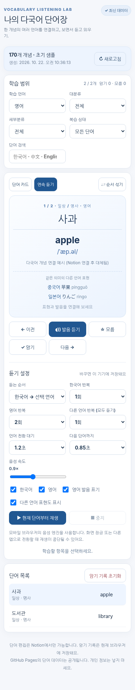

# Vocabulary Listener · Notion + GitHub Pages

Notion에서 **한 개념에 여러 언어의 표현을 연결**하고, 스마트폰/PC에서 글자를 보면서 TTS로 반복 듣는 개인 학습 웹앱입니다.



- **기술**: Vanilla TypeScript / Vite / Node.js 동기화 스크립트 / GitHub Actions / GitHub Pages
- **데이터**: Notion이 유일한 원본입니다. 저장소에는 단어 JSON을 두지 않고, 배포할 때 Actions가 Notion에서 만듭니다
- **학습**: 한국어 → 선택한 언어 (중국어·영어·일본어 등), 언어별 반복/속도/대기시간, 단어 카드, 검색, 복습 상태
- **스크립트 듣기**: 안내 멘트처럼 긴 외국어 글을 문장 단위로 이어 읽고, 읽는 문장을 강조합니다 (선택 기능, [`docs/NOTION-SETUP.md`](docs/NOTION-SETUP.md) 7절)
- **여러 언어 듣기**: 같은 개념에 등록된 표현을 `한국어 → 선택 언어 → 다른 언어 모두` 순서로 재생 가능
- **원본**: Notion의 데이터만 편집합니다. 웹앱에서 단어 추가·수정 기능은 제공하지 않습니다.

## 1. 빠른 시작

Node.js 22.12 이상이 필요합니다. WebStorm 또는 VS Code에서 이 폴더를 열고:

```bash
npm install
npm run data:sample   # 또는 npm run sync:notion (환경 변수 필요)
npm run dev
```

표시되는 로컬 URL로 접속합니다. 앱은 `public/data/words.json`을 읽는데, 이 파일은 git에 올리지 않습니다(`.gitignore`). 로컬에서는 둘 중 하나로 만듭니다.

- `npm run data:sample`: `examples/words.sample.json`의 예시 4개와 `examples/scripts.sample.json`의 스크립트 예시 2개를 복사합니다. 발음 보정과 다국어 연결 예시가 들어 있습니다
- `npm run sync:notion`: 실제 Notion 내용을 받습니다

```bash
npm run check         # 타입 검사, 단위 테스트, Vite 빌드
npm run sync:notion   # Notion API 동기화 (환경 변수 필요)
```

첫 `npm install` 후 생성된 `package-lock.json`을 커밋하고, 재현 가능한 배포를 원하면 `.github/workflows/pages.yml` 설치 명령을 `npm ci`로 교체하세요.

## 2. 한 단어에 여러 언어를 어떻게 저장하나요?

**하나의 Notion 행 = 하나의 의미/개념**입니다. 예를 들어:

| 용어(제목) | 중국어 | 병음 (Pinyin) | 영어 | 영어 발음 | 일본어 | 일본어 읽기 |
|---|---|---|---|---|---|---|
| 사과 | 苹果 | píngguǒ | apple | /ˈæp.əl/ | りんご | ringo |

이렇게 등록하면 한 개념 ID 아래 `ko-KR`, `zh-CN`, `en-US`, `ja-JP` 표현이 함께 저장됩니다.

**번역이 1:1 대응하지 않거나 다의어인 경우에는 뜻마다 행을 분리하는 것을 권장합니다.** 영어 `bank`의 '은행'과 '강둑'은 다른 개념이고, 한국어 '사과'(과일)와 '사과'(잘못을 인정함)도 다른 개념입니다. 향후 더 복잡한 의미 관계나 동의어 N:M 표현은 별도 모델로 확장할 수 있습니다.

Notion 속성:

| 필드 | 권장 타입 | 필수 |
|---|---|---|
| `용어` (한국어 기준 표현) | 제목 | 필수 |
| `중국어`, `영어`, `일본어` | 텍스트 | **이 중 하나 이상** |
| `병음 (Pinyin)`, `영어 발음`, `일본어 읽기` | 텍스트 | 선택 |
| `중국어 예문`, `영어 예문`, `일본어 예문` | 텍스트 | 선택 |
| `중국어 예문 해석`, `영어 예문 해석`, `일본어 예문 해석` | 텍스트 | 선택 |
| `한국어 발음 보정`, `중국어 발음 보정`, `영어 발음 보정`, `일본어 발음 보정` | 텍스트 | 선택, TTS가 잘못 읽을 때만 |
| `대분류`, `분류`, `암기포인트`, `태그` | 선택/텍스트/다중 선택 | 선택 |
| `추가 언어 JSON` | 텍스트 | 선택, 고급 확장 |

예문 해석은 **언어마다 따로** 둡니다. 영어 예문에는 `영어 예문 해석`을, 일본어 예문에는 `일본어 예문 해석`을 적으면 학습 언어를 바꿀 때 해당 언어의 해석이 함께 표시됩니다.

기존 관광통역안내사 Notion 표의 `용어`, `중국어`, `병음 (Pinyin)` 컬럼도 **수정 없이 사용**할 수 있습니다. 새로운 영어·일본어 열만 추가하면 됩니다. 일부 행에만 새 언어를 채워도 되고, 웹앱의 언어 필터는 번역이 실제로 존재하는 행만 표시합니다.

### 언어 추가 (스페인어 등)

데이터 모델과 TTS는 BCP 47 언어 코드를 사용합니다. `추가 언어 JSON` 열에 아래 형식으로 넣으면 코드를 수정하지 않고 새 언어를 추가할 수 있습니다:

```json
{
  "es-ES": {
    "text": "manzana",
    "pronunciation": "",
    "example": "Como una manzana.",
    "exampleTranslation": "나는 사과를 먹는다."
  }
}
```

다만 Notion의 Rich text 속성 텍스트 길이 한계 때문에 예문이 너무 길거나 언어 수가 많으면 별도 구조가 필요할 수 있습니다. 자주 쓰게 되면 `scripts/notion.ts`의 `LANGUAGE_COLUMNS` 배열에 항목 하나를 추가해 정식 컬럼으로 올리세요.

언어 코드는 BCP 47 표준형으로 정규화되어 저장되므로 `ZH-cn`처럼 적어도 `zh-CN`과 같은 언어로 묶입니다. 언어 이름은 `Intl.DisplayNames`가 만들어 주며, 같은 언어의 다른 지역(`zh-CN`과 `zh-TW`)이 함께 있을 때만 지역이 함께 표시됩니다.

## 3. 내부 JSON 데이터 모델

```json
{
  "schemaVersion": 2,
  "source": "notion",
  "updatedAt": "2026-10-22T12:00:00Z",
  "count": 1,
  "words": [{
    "id": "notion-page-id",
    "terms": {
      "ko-KR": { "text": "사과", "pronunciation": "", "example": "", "exampleTranslation": "", "speechText": "" },
      "zh-CN": { "text": "苹果", "pronunciation": "píngguǒ", "example": "", "exampleTranslation": "", "speechText": "" },
      "en-US": { "text": "apple", "pronunciation": "", "example": "", "exampleTranslation": "", "speechText": "" }
    },
    "group": "일상",
    "sub": "명사",
    "note": "",
    "tags": []
  }]
}
```

- `id`는 Notion 페이지 ID로 유지되어 표현을 수정해도 복습 기록은 유지됩니다.
- 복습 기록은 `개념 ID + 학습 언어`를 키로 구분합니다. 중국어를 외웠더라도 영어는 별도로 표시됩니다.
- `speechText`는 TTS 전용 발음 보정입니다. 비어 있으면 `text`를 읽고, 화면 표시와 검색에는 쓰지 않습니다. 선택 필드라 `schemaVersion`은 2 그대로입니다.
- `schemaVersion: 1` 형식의 이전 JSON과 브라우저 캐시는 읽는 시점에 v2로 변환됩니다.
- 초기 샘플 ID와 Notion 페이지 ID는 서로 달라, 처음 연동할 때 샘플의 복습 기록은 연결되지 않을 수 있습니다.

## 4. Notion 연결

**세팅 전체 절차는 [`docs/NOTION-SETUP.md`](docs/NOTION-SETUP.md)에 정리해 두었습니다.** 컬럼을 직접 만들지 말고 [`examples/notion-단어장-template.csv`](examples/notion-단어장-template.csv)를 Notion에 가져오면 23개 컬럼이 한 번에 만들어집니다. 단어는 들어 있지 않습니다.

1. Notion 개발자 설정에서 읽기 권한의 Integration을 만듭니다.
2. 대상 데이터베이스/데이터 소스를 해당 Integration과 공유합니다.
3. GitHub 저장소의 `Settings → Secrets and variables → Actions`에 아래 값을 설정합니다.
   - `NOTION_TOKEN` (필수)
   - `NOTION_DATA_SOURCE_ID` (권장) 또는 데이터 소스가 하나인 경우 `NOTION_DATABASE_ID`
4. 필요하면 로컬 셸에 같은 환경 변수를 설정하고 `npm run sync:notion`을 실행합니다.

Notion API 버전은 `2025-09-03`이며 데이터 소스 조회는 `/v1/data_sources/{id}/query`를 이용합니다. 동기화 도중 오류·0건 응답·잘못된 언어/컬럼/JSON이 나오면 기존 단어 JSON 파일을 덮어쓰지 않고 실패합니다.

## 5. GitHub Pages 배포

1. GitHub 저장소를 만들고 프로젝트 파일을 저장소 루트에 커밋합니다.
2. `Settings → Pages → Build and deployment → Source`를 **GitHub Actions**로 설정합니다.
3. Actions Secrets에 Notion 토큰과 데이터 소스 ID를 설정합니다.
4. `Actions → Sync Notion and deploy GitHub Pages → Run workflow`를 실행합니다.

Notion Secrets가 하나도 없으면 샘플 데이터로 배포되고, 설정이 불완전하면 배포가 중단됩니다. 이후 **약 15분 간격**으로 동기화를 시도하지만 GitHub 예약 작업은 지연·누락될 수 있습니다. 급히 반영하려면 수동 실행하세요.

**중요**: GitHub Pages에 배포한 JSON/웹사이트는 **공개**입니다. Notion Integration 토큰은 GitHub Secrets에서만 사용되지만 단어, 뜻, 메모 등 JSON에 내보내는 정보는 누구나 볼 수 있습니다. 개인 정보나 타인의 유료 콘텐츠를 올리지 마세요.

## 6. 학습 동작과 한계

- **단어 카드**: 한국어 앞면 / 선택 언어 답변 + 발음 표기 + 다른 언어 표현 보기.
- **연속 듣기**: 한국어/선택 언어의 반복 횟수와 대기 시간을 지정. `전체 언어 듣기`에서는 다른 언어도 1회 이상 추가 재생.
- **스크립트**: 별도 페이지 `script/`(예: `https://username.github.io/repo/script/`)에서 듣습니다. 단어장에는 바로가기가 없으니 주소로 직접 열거나 홈 화면에 따로 추가하세요. 선택한 스크립트를 스크립트 언어 음성으로 처음부터 끝까지 읽습니다. 전문 반복(1~3회, 계속), 문장·문단 사이 대기, 속도를 정하고, 문장을 누르면 그 문장부터 읽습니다. 멈춘 위치를 기억해 다음에 이어 듣습니다.
- **언어별 학습 기록**: 모름/암기 표시를 브라우저 로컬 스토리지에 저장하며 PC·휴대폰 간 자동 동기화는 없습니다.
- **모바일 TTS**: Web Speech API를 사용하며 언어별 음성이 OS에 설치되어 있지 않으면 다른 목소리로 대체되거나 재생이 실패할 수 있습니다. **화면 잠금/백그라운드 재생은 보장되지 않습니다.**
- **화면 켜두기**: 연속 재생 중에는 Screen Wake Lock으로 화면이 꺼지지 않게 시도합니다. 지원하는 브라우저(Android Chrome 등)에서만 동작하고 iOS Safari에는 적용되지 않습니다.
- **오프라인**: 서비스 워커가 앱 파일과 단어 JSON을 캐시하므로 두 번째 방문부터는 네트워크 없이도 열립니다. 최초 1회는 온라인 접속이 필요하고, 단어 갱신은 온라인일 때만 반영됩니다.
- **이어서 학습**: 마지막으로 보던 개념을 기억해 앱을 다시 열면 그 위치부터 시작합니다. 기기(브라우저)별로 저장됩니다.

## 7. 폴더와 개발 원칙

```text
src/domain/words.ts    # v2 다국어 개념 모델 + v1 호환 + 런타임 검증
src/domain/scripts.ts  # 스크립트 모델 + 문장 나누기 + 런타임 검증
src/logic/playlist.ts  # 언어별 TTS 재생 계획 (순수 함수)
src/logic/scriptPlaylist.ts # 스크립트 문장 재생 계획 (순수 함수)
src/logic/order.ts     # 무작위 학습 순서 고정 (순수 함수)
src/logic/progress.ts  # 언어별 암기 기록 + v1 이행 (순수 함수)
src/logic/speech.ts    # Web Speech API 어댑터
src/logic/storage.ts   # 언어별 복습 기록/설정/데이터 캐시
src/logic/data.ts      # JSON 로딩
src/logic/page.ts      # 두 페이지 공용 DOM·화면 켜두기·서비스 워커 헬퍼
src/main.ts            # 단어장 페이지 DOM/UI (index.html)
src/scriptPage.ts      # 스크립트 듣기 페이지 DOM/UI (script/index.html)
public/sw.js           # 오프라인 캐시 서비스 워커
scripts/notion.ts      # Notion 필드 매핑/페이지네이션
scripts/sync-notion.ts # 실패 시 원본 유지 + JSON 생성
.github/workflows/     # 자동 GitHub Pages 배포
tests/                 # 단위 테스트
docs/NOTION-SETUP.md   # Notion 데이터베이스 세팅 절차
AGENTS.md              # Codex에 전달할 개발 규칙
```

새 언어에 대한 코드 추가 전에는 `src/domain/words.ts` 모델과 `scripts/notion.ts` 매핑, `src/logic/playlist.ts`를 함께 점검하세요. `src/main.ts`에 특정 외국어 코드를 직접 분기하지 않는 것이 목표입니다.
